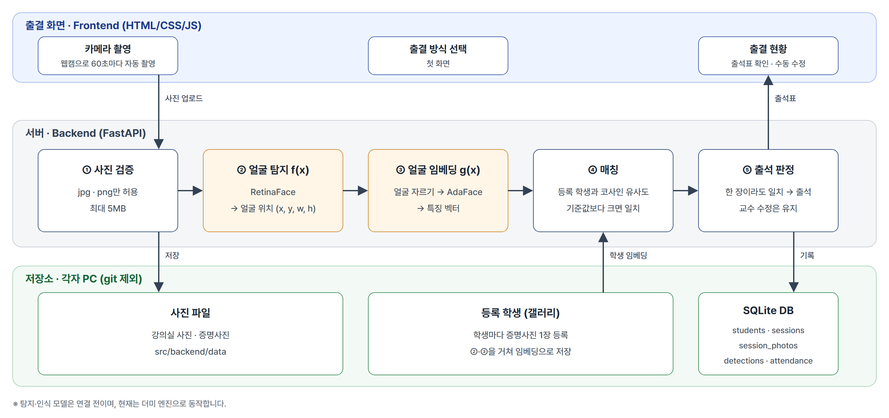

# FR-based Smart Attedance System

> 오픈소스기반기초설계 수업 프로젝트

---

## 개요

- **목적:** 기존 공개된 얼굴인식 및 분류 오픈소스를 정확도를 보다 개선하여 실제 출석에 활용할 수 있는 스마트 출석 시스템을 개발하는 것
- **핵심 기능 요약:** 얼굴인식 -> 데이터베이스에 있는 출석 대상자들과 대조 -> 출석 여부 반영

---

## 핵심 기능

| 기능명 | 설명 |
|---|---|
| 강의실 사진 촬영 | 강의실 카메라로 수업 중 단체 사진을 촬영 |
| 얼굴 탐지 | 단체 사진에서 학생 얼굴 위치를 찾음 |
| 얼굴 인식 | 찾은 얼굴을 수강생 명단의 등록 사진과 대조 |
| 출석 판정 | 한 장이라도 인식되면 출석, 학생별 출석 여부 표 생성 |
| 교수 확인 | 인식되지 않은 학생은 "확인 필요"로 표시, 교수가 최종 확정 |
| 사진 즉시 삭제 | 판정이 끝나면 원본 사진 삭제 (현재 구현은 보관, 정책 논의 중) |

---

## 시스템 아키텍처


---

## 기술 스택

**Frontend**
- HTML / CSS / JavaScript

**Backend**
- Python 3.10+ / FastAPI / Uvicorn
- SQLAlchemy 2.0 / Pydantic

**AI / 모델**
- Face Detection: RetinaFace
- Face Recognition: AdaFace
- PyTorch (추가 예정)

**Database / Infra**
- SQLite

**Test / CI**
- pytest / GitHub Actions

---

## 프로젝트 구조
```
ssuaisw-2026-smart-attedance-system/
│  .env.example                       # 환경 변수 예시 (.env로 복사해 사용)
│  .gitignore
│  CONTRIBUTING.md                    # 규칙 문서
│  main.py                            # 서버 실행 (python main.py)
│  pytest.ini                         # 테스트 설정
│  README.md                          # 프로젝트 소개 문서
│  requirements.txt                   # 의존성
├─.github                             # GitHub 설정 및 자동화
│  │  pull_request_template.md        # PR 템플릿
│  └─workflows
│        test.yml                     # 자동 테스트 (PR마다 pytest)
├─docs                                # 프로젝트 관련 문서 파일
│     face_engine_guide.md            # 얼굴 모델 연결 가이드
├─src
│  ├─frontend                         # 출결 화면 (HTML/CSS/JS)
│  │  └─js                            # 화면별 스크립트, API 호출
│  ├─backend                          # 서버, DB (FastAPI, SQLite)
│  │  ├─routers                       # API: 학생, 수업, 사진, 검출
│  │  ├─services                      # 출석 계산, 얼굴 매칭, 파일 저장
│  │  └─scripts                       # 임베딩 재계산
│  └─exp                              # 실험 코드
│     ├─face-detection                # 얼굴 탐지: 비교, 확정, 튜닝
│     └─face-recognition              # 얼굴 인식
└─tests                               # 백엔드 테스트 (pytest)
```
---

## 설치 방법 (Installation)

### 저장소 클론

``` bash
git clone https://github.com/dddyoung2/ssuaisw-2026-smart-attedance-system.git

cd ssuaisw-2026-smart-attedance-system
```

### 가상환경(.venv) 설치 및 실행

```bash
python -m venv .venv
.venv/Scripts/activate
```

### 의존성 설치

```bash
pip install -r requirements.txt
```

---

## 실행 방법 (Usage)

```bash
python main.py
```

---

## 테스트

```bash
python -m pytest
```
- main으로 가는 PR, main merge 마다 GitHub Actions가 Ubuntu 및 Windows 환경에서 pytest에 정의된 테스트를 자동 실행
- 결과는 PR에서 확인 가능
 
---

## 환경 변수 설정

`.env.example` 파일을 참고하여 `.env` 파일을 생성

```env
DB_URL=
DATA_DIR=src/backend/data
CORS_ORIGINS=http://127.0.0.1:5500,http://localhost:5500
FACE_ENGINE=dummy
THRESHOLD=0.5
USE_VERIFIED_FACES=false
MAX_UPLOAD_MB=5
LOG_LEVEL=INFO
```

---

## 성능 / 벤치마크

| 지표 | 설명 | 결과 |
|---|---|---|
| 얼굴 탐지 재현율 | 사진 속 얼굴 중 찾아낸 비율 | 측정 예정 |
| 출석 판정 정확도 | 학생별 출석·결석 판정이 맞은 비율 | 측정 예정 |
| 처리 시간 | 사진 1장 처리 시간 (CPU, ms) | 측정 예정 |

---

## 팀 (Contributors)

| 이름 | 역할 | GitHub |
|---|---|---|
| 이승호 | **Team Leader**, Face-Recognition Engineer | [](https://github.com/Lsh9716) |
| 김도영 | Face-Detection Engineer | [](https://github.com/dddyoung2) |
| 이예찬 | Full-Stack Engineer | [](https://github.com/dpdcks) |
