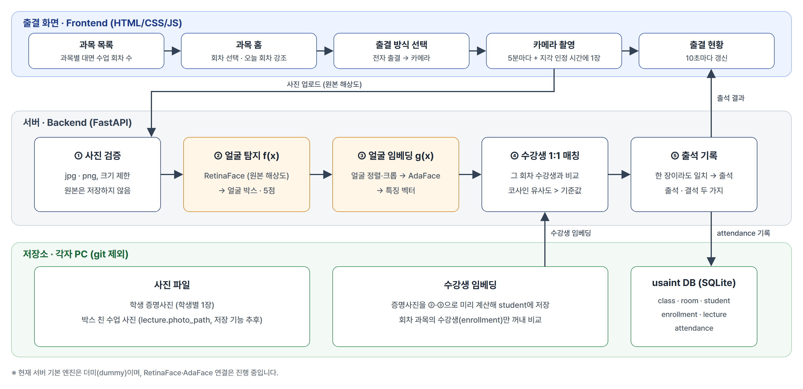
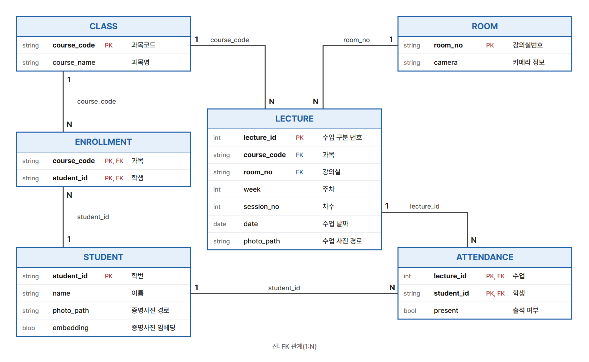

# FR-based Smart Attedance System

> 오픈소스기반기초설계 수업 프로젝트

---

## 개요

- **목적:** 기존 공개된 얼굴인식 및 분류 오픈소스를 정확도를 보다 개선하여 실제 출석에 활용할 수 있는 스마트 출석 시스템을 개발하는 것
- **핵심 기능 요약:** 얼굴인식 -> 데이터베이스에 있는 출석 대상자들과 대조 -> 출석 여부 반영

---

## 핵심 기능

| 기능명 | 설명 |
|---|---|
| 강의실 사진 촬영 | 강의실 카메라로 수업 중 단체 사진을 5분마다 촬영 |
| 실시간 얼굴 탐지 미리보기 | 카메라 화면 위에 탐지된 얼굴 박스와 "탐지된 얼굴 N개"를 표시 (화면을 줄여 검출만, 약 1초마다 갱신. 출석 판정과는 별개) |
| 지각 인정 시간 촬영 | 촬영 시작 후 정한 시간(1~20분)이 지나는 시각에 한 장 더 촬영해, 그때까지 들어온 학생을 확인 |
| 얼굴 탐지 | 단체 사진에서 학생 얼굴 위치를 찾음 |
| 얼굴 인식 | 찾은 얼굴을 수강생 명단의 등록 사진과 대조 |
| 출석 판정 | 한 장이라도 인식되면 출석, 학생별 출석 여부 표 생성 |
| 교수 확인 | 인식되지 않은 학생은 "확인 필요"로 표시, 교수가 최종 확정 |
| 사진 즉시 삭제 | 업로드한 원본 사진은 판정 후 저장하지 않음. 회차별로 얼굴에 박스를 친 수업 사진은 `lecture.photo_path`에 남길 수 있음 (저장 기능은 추후) |

---

## 시스템 아키텍처


---

## 데이터베이스 (ERD)


- 학사 포털(usaint)의 학생·과목·강의실·회차·수강 정보를 흉내 낸 6개 테이블입니다. 우리 시스템은 이 DB를 읽고, 출석 결과(`attendance`)만 씁니다.
- `lecture.photo_path`: 회차별로 얼굴에 박스를 친 수업 사진의 경로입니다. 컬럼만 있고 저장 기능은 추후 작업입니다.

---

## 기술 스택

**Frontend**
- HTML / CSS / JavaScript

**Backend**
- Python 3.10+ / FastAPI / Uvicorn
- SQLAlchemy 2.0 / Pydantic

**AI / 모델**
- Face Detection: RetinaFace (ResNet-50, 원본 크기 입력)
- Face Alignment: CelebA-HQ 방식 정사각형 정렬·크롭 (리사이즈 없음)
- Face Recognition: AdaFace
- PyTorch 2.12 (CPU) / OpenCV

**Database / Infra**
- SQLite

**Test / CI**
- pytest / GitHub Actions

---

## 프로젝트 구조
```
ssuaisw-2026-smart-attedance-system/
│  .env.example                       # 환경 변수 예시 (.env로 복사해 사용)
│  .gitignore
│  CONTRIBUTING.md                    # 규칙 문서
│  main.py                            # 서버 실행 (python main.py)
│  pytest.ini                         # 테스트 설정
│  README.md                          # 프로젝트 소개 문서
│  requirements.txt                   # 의존성
├─.github                             # GitHub 설정 및 자동화
│  │  pull_request_template.md        # PR 템플릿
│  └─workflows
│        test.yml                     # 자동 테스트 (PR마다 pytest)
├─docs                                # 프로젝트 관련 문서 파일
│  │  face_engine_guide.md            # 얼굴 모델 연결 가이드
│  └─images                           # README 그림 (아키텍처, ERD)
├─src
│  ├─frontend                         # 출결 화면: 과목 목록 → 과목 홈 → 출결 방식 → 카메라 → 출결 현황
│  │  └─js                            # 화면별 스크립트, API 호출
│  ├─backend                          # 서버, DB (FastAPI, SQLite)
│  │  ├─engines                       # 얼굴 탐지·인식 엔진
│  │  │  ├─retinaface                 # RetinaFace 모델 코드(MIT), weight/ 가중치 위치
│  │  │  ├─adaface                    # AdaFace 모델 코드(MIT)·가중치 로더, weight/ 가중치 위치
│  │  │  ├─detector.py                # 검출: 박스·5점 랜드마크
│  │  │  ├─align.py                   # 정렬·크롭 (CelebA-HQ 방식, 리사이즈 없음)
│  │  │  ├─fd_pipeline.py             # 검출 → 정렬, 인식 인계 출력 (박스 좌표·정렬 이미지 리스트)
│  │  │  └─embedder.py                # 인식: 정렬 얼굴 → 112 축소 → AdaFace 512차원 임베딩
│  │  ├─routers                       # API: 과목·회차 목록(courses), 회차 시작·사진·출결(lectures), 강의실(rooms), 카메라 미리보기(preview)
│  │  ├─services                      # 출석 처리, 1:1 매칭, usaint DB 조회, 업로드 검증, 미리보기 검출
│  │  └─scripts                       # 학생 임베딩 계산(compute_embeddings), 예시 DB 생성(seed_usaint)
└─tests                               # 백엔드 테스트 (pytest)
```
---

## 설치 방법 (Installation)

### 구글 드라이브 (가중치, 데이터셋)

URL : https://drive.google.com/drive/folders/1Zst0m2AAeyxXrnbKORR69ixqgJrnic38

### 저장소 클론

``` bash
git clone https://github.com/dddyoung2/ssuaisw-2026-smart-attedance-system.git

cd ssuaisw-2026-smart-attedance-system
```

### 가상환경(.venv) 설치 및 실행

```bash
python -m venv .venv
.venv/Scripts/activate
```

### 의존성 설치

```bash
pip install -r requirements.txt
```

---

### 가중치 다운로드

Releases에서 가중치 2개를 받아 아래 경로에 둡니다. (git에는 포함되지 않습니다)

| 모델 | Release | 파일 → 둘 경로 |
|---|---|---|
| 얼굴 탐지 (RetinaFace) | [det-v1.0.0](https://github.com/dddyoung2/ssuaisw-2026-smart-attedance-system/releases/tag/det-v1.0.0) | `Resnet50_Final.pth` → `src/backend/engines/retinaface/weight/` |
| 얼굴 인식 (AdaFace) | [AdaFace_weights_v1.0.0](https://github.com/dddyoung2/ssuaisw-2026-smart-attedance-system/releases/tag/AdaFace_weights_v1.0.0) | `adaface_weight_fined.pt` → `src/backend/engines/adaface/weight/adaface_weight.pt` (이름을 바꿔 저장) |

GitHub CLI로 받을 때 (저장소 루트에서):

```bash
gh release download det-v1.0.0 -p Resnet50_Final.pth -D src/backend/engines/retinaface/weight
gh release download AdaFace_weights_v1.0.0 -p adaface_weight_fined.pt -O src/backend/engines/adaface/weight/adaface_weight.pt
```

AdaFace 가중치는 파인튜닝 가중치이며, 불러올 때 SHA-256을 확인합니다. 다른 파일이면 오류가 납니다.

---

## 실행 방법 (Usage)

```bash
# 1) 예시 데이터 넣기 (usaint.db 를 새로 만듦, 기존 데이터 삭제. "오늘" 회차는 실행한 날짜 기준)
cd src
python -m backend.scripts.seed_usaint
cd ..

# 2) 서버 실행
python main.py
```

| 주소 | 내용 |
|---|---|
| http://127.0.0.1:8000/app/ | 출결 화면 (첫 화면: 과목 목록) |
| http://127.0.0.1:8000/docs | API 문서 (Swagger UI) |

기본 얼굴 엔진(`FACE_ENGINE=retinaface`, 검출 RetinaFace + 인식 AdaFace)은 가중치 2개가 있어야 동작합니다. 가중치 없이, 또는 예시 데이터(합성 사진)로 확인할 때는 `.env`에 `FACE_ENGINE=dummy`를 지정하세요.

자세한 실행 순서와 예시 데이터는 [src/backend/README.md](src/backend/README.md)를 참고하세요.

---

## 테스트

```bash
python -m pytest
```
- main으로 가는 PR, main merge 마다 GitHub Actions가 Ubuntu 및 Windows 환경에서 pytest에 정의된 테스트를 자동 실행
- 결과는 PR에서 확인 가능
 
---

## 환경 변수 설정

`.env.example` 파일을 참고하여 `.env` 파일을 생성

```env
DB_URL=
DATA_DIR=src/backend/data
CORS_ORIGINS=http://127.0.0.1:5500,http://localhost:5500
FACE_ENGINE=retinaface
THRESHOLD=0.5
MAX_UPLOAD_MB=10
LOG_LEVEL=INFO
```

---

## 성능 / 벤치마크

| 지표 | 설명 | 결과 |
|---|---|---|
| 얼굴 탐지 재현율 | 사진 속 얼굴 중 찾아낸 비율 | 96.59% (WACV19 강의실 사진, RetinaFace) |
| 출석 판정 정확도 | 학생별 출석·결석 판정이 맞은 비율 | 측정 예정 |
| 처리 시간 | 사진 1장 처리 시간 (CPU, s) | 12MP 사진 1장 약 10~18초 (CPU) |

---

## 팀 (Contributors)

| 이름 | 역할 | GitHub |
|---|---|---|
| 이승호 | **Team Leader**, Face-Recognition Engineer | [](https://github.com/Lsh9716) |
| 김도영 | Face-Detection Engineer | [](https://github.com/dddyoung2) |
| 이예찬 | Full-Stack Engineer | [](https://github.com/dpdcks) |

---
## 출처

- RetinaFace 모델 코드·가중치: [biubug6/Pytorch_Retinaface](https://github.com/biubug6/Pytorch_Retinaface) (MIT), WIDER FACE로 학습
- AdaFace 모델 코드: [mk-minchul/AdaFace](https://github.com/mk-minchul/AdaFace) (MIT, commit `c60eaa7`의 `net.py` 그대로)
- AdaFace 가중치: [minchul/cvlface_adaface_ir101_webface12m](https://huggingface.co/minchul/cvlface_adaface_ir101_webface12m) (revision `54f602a`, WebFace12M 사전학습)을 CelebAMask-HQ로 파인튜닝한 가중치. 사용 시 AdaFace 논문(Kim et al., CVPR 2022) 인용과 학습 데이터(WebFace12M, CelebAMask-HQ) 라이선스를 따라야 함 (CelebAMask-HQ는 비상업적 연구용)
- 얼굴 정렬 규칙: CelebA-HQ 생성 방식 (Karras et al., Progressive Growing of GANs, 2018)
